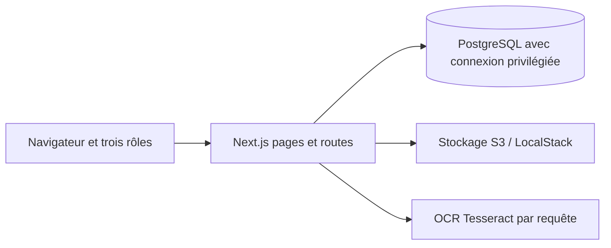
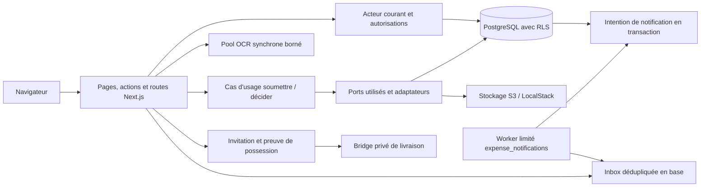

# ARLA-7 / PO-02 — de l'audit aux preuves

Relecture documentaire du 26 octobre 2026. Référence intégrée examinée : [Mindsept main `888a74d`](https://github.com/Mindsept/expense-io/tree/888a74ddae9db28378596adc7709358798986e49). Référence initiale : [`265924b`](https://github.com/Mindsept/expense-io/tree/265924bc7274047989e708ab635c2854d376230f). Les liens figés ci-dessous garantissent la provenance ; ils ne déclarent pas une nouvelle exécution sur le candidat de remise.

**Complément du 26 octobre :** Hugo a explicitement validé les [règles PO-01](regles-et-contrats.md). Le candidat local `f6592bcc53ddceb77038bccda43072355673a54c`, constitué dans le périmètre de sa demande de terminer les tickets, a ensuite passé les huit étapes de CI : 748 tests unitaires, 254 API et 42 E2E. Le nouveau contrôle direct des cinq tables de notifications peuplées est inclus dans les 254 API ; sa [portée RLS](matrice-rls.md) reste précisée. L'intégrateur centralise les preuves courantes dans [MATH-04](../evidence/MATH-04/final-campaign.json). La matrice et le tableau des PR ci-dessous conservent aussi la provenance historique des livrables avant cette intégration ; ils ne remplacent pas une acceptation personnelle ou une répétition collective.

## Sources et niveaux de preuve

L'audit Mindsept du 18 octobre (`audit-et-plan-equipe.md`, dossier local d'audit de l'équipe) a distingué analyse statique, reproductions locales du 16 octobre et simulations avec doubles. L'index reprend ses chantiers C1–C9, pas les résultats des camarades. Les constats avant correction se retrouvent dans la référence initiale et les preuves des auteurs. Aucune application ni suite d'un autre groupe n'est revendiquée comme exécutée ici.

Sources de cours vérifiées le 26 octobre dans les fichiers fournis : `2026_ARLA_Cours 1 & 2.pptx`, diapositives 15, 20, 32, 37–40, 44–49 ; `ARLA 2026 Cours 3.pptx`, diapositives 7, 18–21, 23–28 et 30–32. La diapositive 49 confirme une présentation de 15 minutes et un ajout assisté de 15 minutes. Le barème de la diapositive 38 de cours 3 reste une référence du dossier initial ; son tableau graphique n'a pas été retranscrit dans cette relecture. Cours 4/5 et éventuels E2E professeurs séparés : non fournis dans ce périmètre.

| Niveau | Ce qu'il prouve | Ce qu'il ne prouve pas seul |
| --- | --- | --- |
| Statique | Présence d'un chemin, contrat, contrôle ou absence recherchée dans une version | Exécution réussie, absence de tout défaut |
| Unitaire / doubles | Règle et panne contrôlée au niveau testé | PostgreSQL, S3, rôles réels et livraison externe |
| API / SQL local | Échanges HTTP/SQL réels indiqués dans la fixture | RLS si la connexion est privilégiée, parcours utilisateur complet |
| Navigateur | Interaction dans un vrai navigateur ; interceptions explicites le cas échéant | Persistance réelle lorsque l'API est simulée, conformité WCAG globale |
| CI | Commandes et assertions du run lié, avec SHA/environnement | Acceptation produit, tests non collectés, réception humaine |
| Mesures | Durées de la campagne, protocole et machine indiqués | SLO, capacité de production ou comparaison entre protocoles différents |
| Réception humaine | Parcours réellement observé et décision signée par la personne | Résultat d'une personne absente ou résultat technique non exécuté |

## Matrice C1–C9

Le SHA `888a74d` ci-dessous signifie **preuve publiée dans la référence intégrée**. Les SHA exacts d'exécution conservés à l'intérieur des rapports restent ceux à citer pour leurs résultats. Les fichiers de tests sont une référence de scénario, pas une preuve qu'ils viennent d'être rejoués.

| Chantier / défaut initial et impact | Tickets / responsable | Choix réellement observable | Preuves après et provenance | Concept du cours | Résultat et limite |
| --- | --- | --- | --- | --- | --- |
| **C1** : aucun socle de tests/CI ; régressions invisibles | ARLA-39/40, Mathis ; ARLA-38, Elyes | Runners unit/API/E2E, collecte par propriétaire, stack jetable et chaîne de production | [CI main 40217509555](https://github.com/Mindsept/expense-io/actions/runs/40217509555), [MATH-02](../evidence/MATH-02-validation.md), [EL-08 à `db3dab6`](https://github.com/Mindsept/expense-io/blob/db3dab614bb18ef236a1ff60da7f59d721f43e7a/docs/evidence/EL-08/README.md) | C1–2 s47/49 : testabilité ; C3 s38 : barème | Socle intégré ; EL-08 en PR #31 au relevé. Les smokes de connexion ne prouvent pas tout le cycle métier. |
| **C2** : secret public, affiliation par domaine, droits interentreprises et DB privilégiée | ARLA-10/11/13/14, Hamza | Configuration privée, acteur courant, invitations explicites, web limité et RLS forcée | [HA-01](../evidence/HA-01-validation.md), [HA-02](../evidence/HA-02-2026-10-22/summary.json), [HA-04 runtime](../security/HA-04/runtime-isolation.md), [HA-05](../invitation-enrollment.md), référence `888a74d` | C3 s25–27 : identité et autorisation ; C1–2 s32 : frontières | Intégré. [Matrice des 13 tables](matrice-rls.md) distingue garde structurel et refus testés. Livraison réelle des emails non certifiée. |
| **C3** : tri libre SQL, entrées ambiguës, erreurs techniques et contrats divergents | ARLA-16, Hamza ; ARLA-19/28, Leandro | Tri fermé, validation de décimaux/dates/fichiers, erreur commune et OpenAPI | [LE-01](../evidence/LE-01-validation.md), [HA-07](../api-errors.md), [OpenAPI courant v5](../openapi/expense-io.v5.json), référence `888a74d` | C3 s7/23/24/30–32 : frontière, contrat, versionnement, erreurs | Intégré. Choix produit complémentaires validés dans [PO-01](regles-et-contrats.md), limites des formats distinctes d'un antivirus. |
| **C4** : règles répétées dans les routes, abstractions inutilisées | ARLA-12/15, Hamza ; ARLA-30, Leandro | DecideExpense / SubmitExpense réellement composés avec ports/adaptateurs et DTO partagé | [ADR décision](../adr/HA-03-atomic-decisions.md), [soumission](../expense-submission.md), [DTO](../contracts/expense-note.md), référence `888a74d` | C1–2 s32/44–48 : découplage, inversion, pragmatisme | Tranches métier intégrées dans un monolithe ; aucune « architecture hexagonale complète » revendiquée pour chaque fichier. |
| **C5** : note sans reçu ou doublon après panne/retry ; notification non fiable | ARLA-20/21, Leandro ; ARLA-34, Elyes ; ARLA-18, Hamza | Soumission avec compensation/réconciliation, clé stable de reprise ; décision/historique/intention atomiques et inbox dédupliquée | [LE-02](../evidence/LE-02-validation.md), [LE-03](../evidence/LE-03-idempotency.md), [HA-09 runtime](../evidence/HA-09-Runtime-2026-10-25/README.md), [EL-04](../../tests/e2e/elyes/EL-04/submission-intent.spec.ts), référence `888a74d` | C3 s28 ; C1–2 s20/40 : idempotence, reprise, compromis | Intégré. SQL ne rend pas S3 transactionnel. Les tests d'UI interceptés sont distincts des tests DB/S3 réels. |
| **C6** : décisions concurrentes écrasées, cycles, auteurs sans circuit | ARLA-12/15, Hamza ; ARLA-36, Elyes | Transition unique, historique, droits courants, recours RH et état sans valideur | [HA-03](../evidence/HA-03-2026-10-22/summary.json), [HA-06](../management-hierarchy.md), [EL-06](../../tests/e2e/elyes/EL-06/workflow-visibility.spec.ts), référence `888a74d` | C1–2 s32/47 ; C3 s31/32 : règles, conflit | Intégré ; décisions produit 22/25 octobre. Les anciens événements n'ont pas d'auteur inventé rétroactivement. |
| **C7** : OCR non borné, mauvais total extrait, dates décalées et UI bloquée | ARLA-22/23/24, Leandro ; ARLA-31/32/33/37, Elyes | Parseur/corpus, pool borné, suggestion protégée, date civile, états d'erreur et accessibilité | [LE-04](../evidence/LE-04-validation.md), [LE-05](../evidence/LE-05-resource-limits.md), [LE-06](../adr/LE-06-bounded-ocr.md), [tests Elyes](../../tests/e2e/elyes), [EL-07 à `db3dab6`](https://github.com/Mindsept/expense-io/blob/db3dab614bb18ef236a1ff60da7f59d721f43e7a/docs/evidence/EL-07-accessibility.md) | C1–2 s37–40/48 ; C3 s19–21 : traitement long et choix synchrone/async | Base intégrée sauf EL-07 en PR #31 au relevé. Pas de file OCR durable ; ni précision universelle OCR ni certification WCAG. |
| **C8** : listes non bornées, mesures absentes, seed destructif et alertes dépendances | ARLA-17, Hamza ; ARLA-25/26/27/29, Leandro ; ARLA-35, Elyes ; ARLA-41/43/44/45, Mathis | Pagination complète, diagnostic, index mesuré, mises à jour ciblées ; seed et restauration protégés en PR | [LE-07](../evidence/LE-07-pagination.md), [LE-08](../evidence/LE-08-observability.md), [LE-09](../evidence/LE-09-measured-queries.md), [LE-11](../evidence/LE-11-bounded-defaults.md), [MATH-07](../evidence/MATH-07/hamza-refresh-2026-10-23/README.md), [revue performance](revue-performance-20261026.md) ; PR #27/#17/#33 ci-dessous | C1–2 s20/40 ; C3 s18 : mesures, exploitation, pagination | Pagination/index/dépendances intégrés. Exploitation et nouvelle référence en PR au relevé ; chaque mesure garde son protocole. |
| **C9** : décisions et preuves dispersées, soutenance non répétée | ARLA-6/7/8/9, Hugo ; ARLA-42, Mathis | Règles, index, architecture, recette et déroulé préparés | Ce dossier, [MATH-04 initial à `6842c59`](https://github.com/Mindsept/expense-io/blob/6842c59cc674c47fcc7679ff1122cffa131ebd50/docs/recette-finale.md), [soutenance](soutenance.md) | C1–2 s15/20/49 ; C3 s38 | Règles validées et CI du candidat réussie ; acceptation personnelle et répétition collective restent à observer. |

Cette couverture inclut les **40 tâches ARLA-6 à ARLA-45** ; C4/C6 partagent des tickets, sans doubler le travail. Les cinq epics ne sont pas des livraisons supplémentaires. L'avancement Jira est une photographie de tickets, pas un pourcentage pondéré de code ou de qualité.

## Provenance des livrables avant intégration du candidat

Ce tableau conserve les SHA et campagnes de chaque branche au premier relevé. Ces livrables sont désormais réunis dans le candidat local `f6592bc` ; les mentions de campagne à compléter décrivent leur état à ces SHA historiques.

| PR | Tête publiée vérifiée | Preuve / portée |
| --- | --- | --- |
| [#31 EL-07/08](https://github.com/Mindsept/expense-io/pull/31) | `db3dab614bb18ef236a1ff60da7f59d721f43e7a` | [CI](https://github.com/Mindsept/expense-io/actions/runs/40207171829) ; campagne Windows applicative sur `02ec22e`, documentée séparément du commit de preuves. |
| [#27 MATH-03](https://github.com/Mindsept/expense-io/pull/27) | `82e88df8cb383fd771ce47ed660a9b6ff6d6edf2` | [CI 695/253/29](https://github.com/Mindsept/expense-io/actions/runs/40238564482) ; guide/Windows/réception à compléter sur la version retenue. |
| [#17 MATH-05](https://github.com/Mindsept/expense-io/pull/17) | `ae7d7dc1e72ce04db4cef8fa1c1bdaee67b0df10` | Mesures sur `ad51a01`, [CI 708/242/29](https://github.com/Mindsept/expense-io/actions/runs/40239646020) ; la revue des bruts ne remplace pas la réception Leandro. |
| [#33 MATH-06](https://github.com/Mindsept/expense-io/pull/33) | `d566e3277117b74e26887d8e8748e268f0c430c6` | [CI 701/242/29](https://github.com/Mindsept/expense-io/actions/runs/40238545915) ; cycle macOS publié et campagne Windows historique distincte. |
| [#32 MATH-04](https://github.com/Mindsept/expense-io/pull/32) | `6842c59cc674c47fcc7679ff1122cffa131ebd50` | [CI 678/242/29](https://github.com/Mindsept/expense-io/actions/runs/40243290163) ; dossier préparé, pas une recette finale. |
| [#30 compatibilité Windows](https://github.com/Mindsept/expense-io/pull/30) | `5b7c992d05e8bd05890117ff64c2b65db388d435` | Chemins d'inventaire OpenAPI portables ; correctif également inclus dans #31. Vérifier l'ascendance avant toute intégration supplémentaire. |

## Architecture : référence initiale puis système intégré

Au départ, les routes regroupaient règles et accès DB/S3 ; un dossier « domain » ne prouvait pas son utilisation. Le schéma suivant représente la version initiale auditée, pas les correctifs désormais intégrés.

Dans `888a74d`, les chemins réellement appelés sont plus explicites. L'OCR reste synchrone ; l'asynchrone durable concerne les notifications en base. Le bridge d'invitation est une frontière de livraison configurée, pas un fournisseur réel déjà certifié.

Sources du schéma : `src/application`, `src/adapters`, `src/lib/current-actor.ts`, `runtime-database.ts`, `notifications/inbox.ts`, `enrollment/delivery.ts`, `ocr-pool.mjs` et `scripts/notifications/worker.mjs`. Les outils seed/backup/restore sont des processus opérateur séparés ; ils ne deviennent pas des pouvoirs du serveur web.

## Décisions à défendre, pas des patterns à réciter

| Décision | Alternative écartée et coût | Preuve / auteur |
| --- | --- | --- |
| Monolithe modulaire, extraction progressive | Microservices : transactions/distribution et exploitation supplémentaires sans besoin mesuré | [HA-03](../adr/HA-03-atomic-decisions.md), Hamza ; [LE-02](../expense-submission.md), Leandro |
| Décision conditionnelle + audit dans la même transaction | Lecture puis écriture libre : décision perdue ; historique après commit : trou d'audit | [HA-03](../adr/HA-03-atomic-decisions.md), Hamza |
| Idempotence durable + compensation/réconciliation | Retry aveugle ou « transaction SQL + S3 » fictive : doublons/orphelins | [LE-03](../expense-idempotency.md), Leandro |
| OCR synchrone borné, saisie manuelle disponible | File durable : jobs, états, reprise et coût d'exploitation non justifiés par les mesures actuelles | [ADR LE-06](../adr/LE-06-bounded-ocr.md), Leandro ; choix Hugo |
| Pagination et index après mesure | Ajouter un index sans contre-mesure : coût d'écriture/stockage sans gain garanti | [LE-09](../evidence/LE-09-measured-queries.md), Leandro ; référence Mathis |

## Usage de l'IA et acceptation

Codex a aidé à relire, implémenter certains correctifs et exécuter des campagnes. Exemple vérifiable : la première campagne EL-07/08 a détecté trois débordements à petit écran ; le correctif a été testé et les échecs initiaux conservés. Un contrôle négatif temporaire de la clé de reprise a fait échouer les scénarios attendus, puis la source a été restaurée avant le passage positif. Ce sont des preuves du processus de vérification, pas une appréciation personnelle sur les auteurs.

Le 26 octobre, la présente revue a recalculé les statistiques publiées de MATH-05 et relié les scénarios aux 13 tables. Aucun benchmark neuf ni contrôle humain n'a été ajouté par simple rédaction.

- [ ] Propriétaires relisent les faits de leurs lignes et signalent les écarts.
- [x] Candidat `f6592bc` identifié et campagne CI exécutée avec succès ; preuve détaillée centralisée par l'intégrateur dans MATH-04.
- [x] Hugo valide les compléments de règles PO-01 le 26 octobre.
- [ ] Hugo accepte les parcours observés et les limites de remise.
- [ ] L'équipe répète le déroulé et chacun explique son propre diff.
